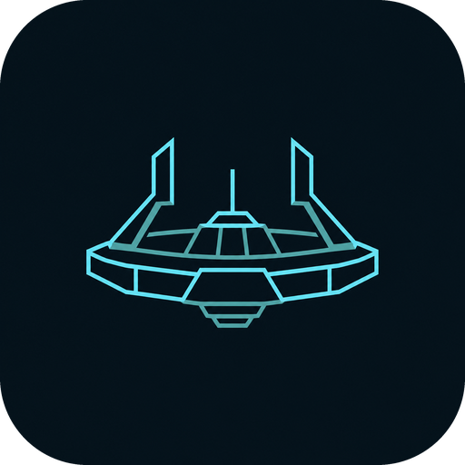

  

<h1 align="center">DroidUA</h1>

  <b>Urban Assault on Android</b>: an unofficial port of <a href="https://github.com/Marisa-Chan/UA_source">OpenUA</a>
   
  <a href="https://github.com/eightiesjapan/DroidUA/releases"><b>Download the beta »</b></a>

  <a href="#installing">Install guide</a> ·
  <a href="#controls">Controls</a> ·
  <a href="https://github.com/eightiesjapan/DroidUA/issues">Report a bug</a> ·
  <a href="https://metropolisdawn.de/filebase/file/10-openua-standalone-package-full-game/">Get the game files</a>

---

DroidUA brings Urban Assault (Microsoft / TerraTools, 1998) to Android phones and handhelds. It's a *port of a port*: this repository is a fork of **OpenUA / UA_source** by Marisa-Chan and contributors, the open-source re-creation of the Urban Assault engine that made the Windows version possible. DroidUA adds the Android app, touch and gamepad controls, display and performance work on top of it.

> This is a non-commercial community mod project made by a fan. It is not affiliated with or endorsed by Microsoft or TerraTools. **No original game files are included**: you need your own copy of the game data (see [Installing](#installing)).

**Status:** public beta (0.8). Tested on a **Google Pixel 9a** (phone, Android 17) and an **Anbernic RG477V** (Android handheld with built-in controls). Other devices should work but haven't been tested yet.

---

## Credits

- **OpenUA / UA_source:** Marisa-Chan and contributors, the engine this whole project is built on. Without the Windows port, DroidUA wouldn't exist.
- **Metropolis Dawn / Stoudson Corporation community:** for keeping Urban Assault alive and hosting the game package.
- **Urban Assault:** © Microsoft / TerraTools. The original game content remains the property of its owners.
- **DroidUA:** coordinated, designed and play-tested by eightiesjapan.

### About AI assistance

DroidUA was developed with the help of AI coding assistants: **OpenAI GPT (Sol and Astra)** and **Anthropic Claude**. They wrote most of the Android-specific code, the performance changes and the build setup, under my direction. I chose what to build, decided on the design and tested every build by hand on real devices. All code is published here so anyone can review it.

---

## Features

**Built for touch**
- On-screen controls you can move, show/hide and resize (opacity slider), with a drag-and-drop layout editor.
- A vertical **MOVE** slider (forward/back) and a **LOOK / PAN** pad, plus Fire, Alt, Brake, Leader, Lead and optional map/squad buttons.
- **No right-click needed.** The game switches between VIEW (driving/aiming) and SELECT (pointer) mode for you:
  - closing the map or squad manager, or switching vehicle creation off → back to VIEW
  - returning to the host station → VIEW
  - entering a vehicle → VIEW
- **Double-tap a vehicle to jump into it**, in VIEW or SELECT mode, from the host station or another vehicle.
- Tap the original HUD buttons directly; a bigger, easy-to-grab map resize handle.

**Handhelds and gamepads**
- Full gamepad support with remappable buttons (Main menu → Gamepad Settings).
- Bluetooth mice work too.

**Display**
- Original 4:3 or full widescreen in missions.
- On wide screens, the 4:3 menus get side panels generated from the game's own menu artwork (nothing extra is bundled).
- Separate **Menu size** and **HUD size** (Standard / Large / Extra large) settings, larger touch-friendly menu buttons in the original style, and **Invert Look**.

**Performance**
- All native code fully optimised for 64-bit ARM.
- Explosions and particle effects drawn in batches (far fewer draw calls in big battles).
- Cheaper render sorting and distance fading; shaders cached between sessions (fewer stutters).
- Steady 60 FPS on both test devices; frame-rate hint for 120 Hz phones.

**Quality of life**
- Opens straight into the game once your files are imported; **Options → Exit to Launcher** for backups.
- Save backup/restore to a ZIP, with undo.
- Replaying a completed mission starts it fresh.
- Crash reports are saved locally (Download/DroidUA); nothing is uploaded.

---

## Requirements

- Android 7.0 or newer, **64-bit ARM** device (almost every phone from the last several years)
- OpenGL ES 2.0 graphics
- About **2 GB** free space during import (the game itself uses ~400 MB)
- Your own copy of the game data (below)

---

## Installing

**1. Get the game files.** Download the **OpenUA Standalone Package (full game)** from Metropolis Dawn:
👉 https://metropolisdawn.de/filebase/file/10-openua-standalone-package-full-game/

Extract it on your PC. You need the folder that contains `DATA`, `ENV`, `LEVELS`, `fonts`, `res` and `NUCLEUS.INI`.

**2. Copy that folder to your Android device**, e.g. into `Download/UrbanAssault/`.

**3. Install DroidUA.** Download the APK from the [Releases](../../releases) page and open it on your device. Android may ask you to allow installing apps from your browser or file manager; allow it for this install.

**4. Import the game.** Open DroidUA → **Import game files** → pick the folder from step 2 → **Use this folder**. The files are copied into the app, so you can delete your copy afterwards.

**5. Play.** From now on DroidUA opens straight into the game.

**Updating:** install a newer APK over the old one. Your saves and settings are kept. Don't uninstall first: uninstalling deletes your saves (use **Back up saves** in the launcher if you need to).

---

## Controls

### Phone (touch)

| Control | What it does |
|---|---|
| **MOVE** slider (left) | Drive forward / back; springs back to centre |
| **LOOK** pad (right) | Steer and aim; becomes **PAN** to scroll an open map |
| **FIRE** / **ALT** | Primary / alternate weapon |
| **BRAKE** | Brake, auto-level, VTOL hover |
| **VIEW / SELECT** | Switch between driving and pointer mode (mostly automatic) |
| **LEADER** / **LEAD** | Jump to your squad leader / become squad leader |
| Tap the screen | Click HUD buttons, select units and targets |
| Double-tap a vehicle | Jump into it |

Change everything in **Options**: Touch controls (Automatic / Show / Hide), Touch screen → **Edit layout**, Touch opacity, HUD size, Invert Look.

### Handheld / gamepad (defaults)

| Button | What it does |
|---|---|
| Left stick | Drive forward / back (moves the cursor in menus) |
| Right stick | Look and aim; pans an open map |
| **A** | Open / close vehicle creation |
| **D-pad up / down** | Pick a vehicle in the creation list |
| **L1** | Click / place / drag; double-click a vehicle to enter it |
| **R1** | Switch VIEW / SELECT |
| **L2** / **R2** | Fire / alternate weapon |
| **B** | Brake, auto-level, VTOL |
| **X** / **Y** | Jump to squad leader / become squad leader |
| **Select** | Map |
| **Start** | Game menu |

In menus: **A / L1** click, **B** back. Remap A/B/X/Y, L1/L2/R1/R2 and L3/R3 in **Main menu → Gamepad Settings**.

---

## What's not done yet / known issues

- **Multiplayer** hasn't been tested on Android.
- Only tested on two devices, both with ARM Mali graphics. Phones with Qualcomm (Adreno) graphics may behave differently, so reports are very welcome.
- Story videos play in 4:3 with black bars on wide screens.
- The Metropolis Dawn expansion campaigns aren't set up as separate launch options.
- The PC version's help pages aren't available on Android.

Found a bug? Open an [issue](../../issues) with your device model, Android version, what you were doing, and touch/gamepad/mouse. After a crash, reopen DroidUA: a report ZIP is saved in `Download/DroidUA`. Please attach it.

---

## Building from source

The Android project is in [`android/`](android/), the engine in [`src/`](src/). See [`BUILDING.md`](BUILDING.md) for the toolchain, the pinned library versions and the small gl4es patch in [`android/patches/`](android/patches/).

The original OpenUA README (desktop build notes, fonts, extra `nucleus.ini` keys) is kept in [`README-OpenUA.md`](README-OpenUA.md).

## License

The engine and DroidUA's code are licensed under the **GNU GPL v2**, like OpenUA. Bundled libraries keep their own licences (SDL2, gl4es, OpenAL Soft, Ogg/Vorbis, FreeType, Lua, pl_mpeg); see the app's **About → Licences** screen. Fonts: Liberation, Xolonium and Press Start 2P (SIL OFL), Textar (IPA). Urban Assault's artwork, music, videos and other game content are **not** covered by this licence and are not distributed here.
